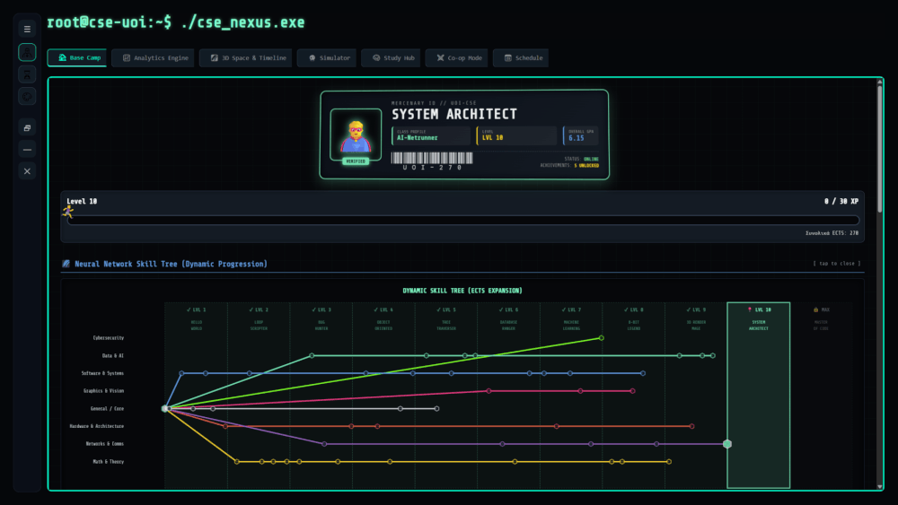
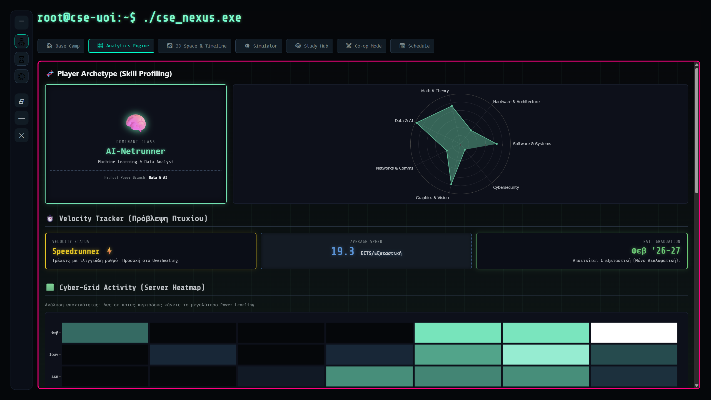
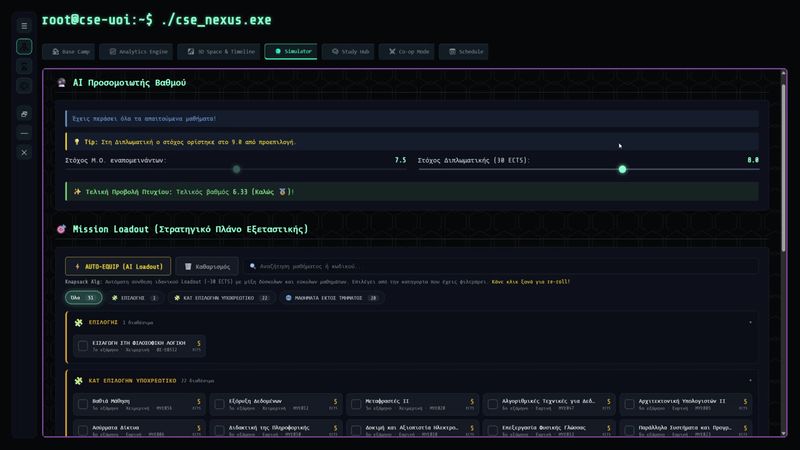
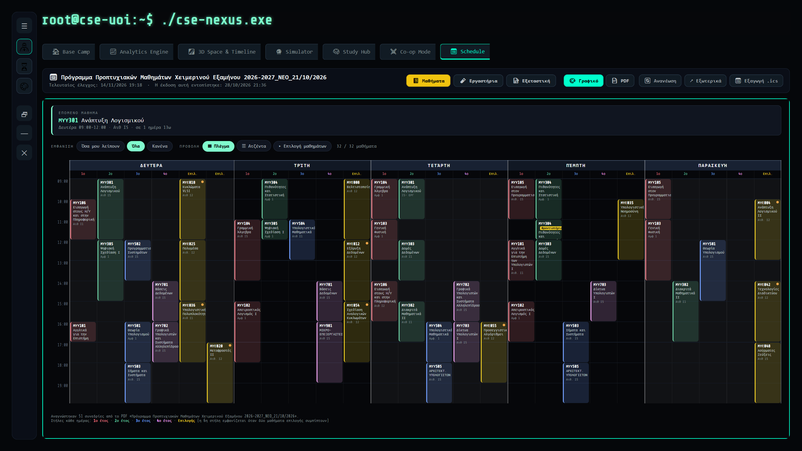
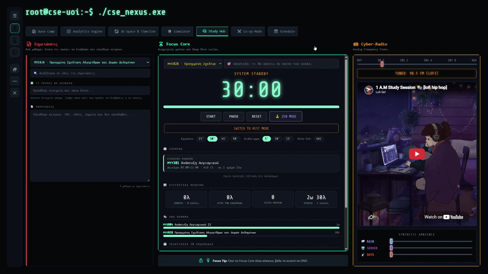

<div align="center">
  <h1>🎓 CSE Nexus</h1>
  <p><b>Το απόλυτο Gamified Academic Dashboard & Study Hub για τους φοιτητές του ΤΜΗΥΠ (Πανεπιστήμιο Ιωαννίνων)</b></p>

  [
  []()
  []()
  [](LICENSE)
</div>

<br/>

> ⚠️ **Ανεπίσημη Εφαρμογή:** Το CSE Nexus αποτελεί ανεξάρτητο, open-source project και **δεν** σχετίζεται, υποστηρίζεται ή συντηρείται από το Πανεπιστήμιο Ιωαννίνων. Διαβάστε προσεκτικά την [Αποποίηση Ευθύνης](#-αποποίηση-ευθύνης).

---


<div align="center">
  
</div>


## ✨ Βασικά Χαρακτηριστικά

- 🏠 **Base Camp:** Ένα gamified προφίλ RPG! Παρακολούθησε τα XP σου, ανέβα levels, ξεκλείδωσε επικά επιτεύγματα (Achievements), δες το Hall of Fame σου και κάνε εξαγωγή το progress σου απευθείας σε `progress.md` για το GitHub προφίλ σου.
  <details>
  <summary>👉 <b>Κλικ για προβολή:</b> Base Camp Highlights 📸</summary>
  <br>
  
  </details>
<br>

- 📈 **Analytics Engine & 3D Space:** Διαδραστικά γραφήματα βαθμολογιών, εκτίμηση εξαμήνου αποφοίτησης (Velocity Tracker) και ένα Dynamic Skill Tree βάσει των μαθημάτων που έχεις περάσει.
  <details>
  <summary>👉 <b>Κλικ για προβολή:</b> Στατιστικά & Skill Tree 📸</summary>
  
  
  </details>
  <br>

- 🔮 **Simulator:** Σχεδίασε το Loadout της επόμενης εξεταστικής (Knapsack algorithm) και δες live πώς οι στόχοι σου θα επηρεάσουν τον τελικό μέσο όρο.
  <details>
  <summary>👉 <b>Κλικ για προβολή:</b> Simulator σε δράση 🎬</summary>
    <br>
    
    </details>
  <br>

- 📅 **Live Schedule:** Το πρόγραμμα μαθημάτων, εργαστηρίων και εξεταστικής αντλείται (crawling) απευθείας από το site του Τμήματος και μετατρέπεται σε ένα πανέμορφο γραφικό πλέγμα. Υποστηρίζει εξαγωγή σε `.ics` για άμεσο import σε Google Calendar & Outlook.
  <details>
  <summary>👉 <b>Κλικ για προβολή:</b> Live Schedule 📸</summary>
  
  
  </details>
  <br>

- 🧠 **Deep Dive Study Hub:** Απόλυτη συγκέντρωση. Ενσωματωμένο Focus Core (Pomodoro) με Zen Mode, log μελέτης, Scratchpad σημειώσεων ανά μάθημα και Cyber-Radio (lo-fi/ambient) για να μένεις στο zone.
  <details>
  <summary>👉 <b>Κλικ για προβολή:</b> Zen Mode & Study Hub 🎬</summary>
  
  
  </details>
  <br>

- ⚔️ **Co-op Mode:** Σύγκρινε τα στατιστικά σου (Arcade Matchup) με φίλους, κάνοντας import το `.json` (ή `.csv`) αρχείο τους.
---

## 🚀 Λήψη και Εκτέλεση

Το CSE Nexus είναι μια **Self-Contained** εφαρμογή. Αυτό σημαίνει ότι **δεν χρειάζεται να εγκαταστήσεις τίποτα** (ούτε .NET, ούτε βιβλιοθήκες, ούτε installers).

1. Πήγαινε στη σελίδα **[Releases](https://github.com/panagiotispar/cse-nexus/releases/latest)**.
2. Κατέβασε το πιο πρόσφατο αρχείο ZIP (π.χ. `CSE-Nexus-v1.0.0-win-x64.zip`).
3. Κάνε **Δεξί κλικ ➔ Εξαγωγή όλων (Extract All)** στον φάκελο που κατέβασες. *(Μην τρέξεις την εφαρμογή μέσα από το ZIP!)*
4. Μέσα στον αποσυμπιεσμένο φάκελο, κάνε διπλό κλικ στο **`CSE Nexus.exe`**.

> **Απαιτήσεις Συστήματος:** Windows 10 ή Windows 11 (64-bit) και ενεργή σύνδεση στο Internet για τον συγχρονισμό με το ClassWeb.

### 🛡️ Αντιμετώπιση Προβλημάτων & Συχνές Ερωτήσεις (FAQ)

<details>
<summary><b>Μου βγάζει οθόνη «Τα Windows προστάτευσαν τον υπολογιστή σου» (SmartScreen)</b></summary>

Η εφαρμογή είναι ανοιχτού κώδικα (open-source) αλλά δεν διαθέτει ακριβή εμπορική ψηφιακή υπογραφή. Αν εμπιστεύεσαι την πηγή, πάτα <b>Περισσότερες πληροφορίες (More info)</b> και μετά <b>Εκτέλεση ούτως ή άλλως (Run anyway)</b>.
</details>

<details>
<summary><b>Η πρώτη εκκίνηση αργεί λίγο. Είναι φυσιολογικό;</b></summary>

Ναι, απολύτως. Κατά την πρώτη εκκίνηση, η Self-Contained εφαρμογή αποσυμπιέζει σιωπηλά τα εσωτερικά αρχεία του .NET σε έναν προσωρινό φάκελο των Windows. Οι επόμενες εκκινήσεις θα είναι ακαριαίες.
</details>

<details>
<summary><b>Ζητάει το «WebView2 Runtime». Τι είναι αυτό;</b></summary>

Το WebView2 είναι η μηχανή που χρησιμοποιεί το CSE Nexus για να αποδώσει το Cyberpunk UI του. Στα Windows 11 (και στα ενημερωμένα Windows 10) είναι προεγκατεστημένο. Αν λείπει από το σύστημά σου, η εφαρμογή θα σε παραπέμψει στην <a href="https://developer.microsoft.com/en-us/microsoft-edge/webview2/#download-section">επίσημη και δωρεάν λήψη από τη Microsoft</a>.
</details>

<details>
<summary><b>Πώς κάνω Update την εφαρμογή; Χάνω την πρόοδό μου;</b></summary>

Όταν κυκλοφορεί νέα έκδοση, απλά κατεβάζεις το νέο <code>.zip</code> από τα Releases και αντικαθιστάς τον παλιό σου φάκελο. <b>Τα δεδομένα σου, η πρόοδος, τα themes και τα XP σου ΔΕΝ χάνονται!</b> Όλα αποθηκεύονται με ασφάλεια σε ξεχωριστό φάκελο των Windows (<code>%LocalAppData%\UoiStudyHub</code>).
</details>

---

## 🔒 Ιδιωτικότητα & Ασφάλεια Δεδομένων

Η ιδιωτικότητα είναι δομικό στοιχείο του CSE Nexus (Privacy by Design).

*   **Κωδικοί Πρόσβασης:** Ο κωδικός σου για το ClassWeb αποθηκεύεται **μόνο** αν τσεκάρεις την επιλογή «Να θυμάμαι τα στοιχεία». Αποθηκεύεται **κρυπτογραφημένος** τοπικά, χρησιμοποιώντας το Windows Data Protection API (DPAPI), δεμένος κρυπτογραφικά με τον λογαριασμό χρήστη σου στα Windows. Η εφαρμογή τον στέλνει *αποκλειστικά* στο `sso.uoi.gr`.
*   **Τοπική Αποθήκευση (Zero Telemetry):** Οι βαθμοί, το ιστορικό μελέτης (Pomodoro log), τα Boss milestones και η πρόοδός σου μένουν **αυστηρά τοπικά** στον υπολογιστή σου (`%LocalAppData%\UoiStudyHub`). Δεν στέλνονται πουθενά. Η εφαρμογή δεν διαθέτει κανενός είδους trackers ή telemetry.
*   **Εξωτερικές Συνδέσεις:** Το app επικοινωνεί μόνο με: `sso.uoi.gr` / `classweb.uoi.gr` (σύνδεση & άντληση βαθμών), `cse.uoi.gr` (crawling προγράμματος), Google Fonts, YouTube (για το Cyber-Radio) και ένα επίσημο CDN για τη βιβλιοθήκη γραφημάτων Plotly.js.
*   **Απόλυτη Διαγραφή (Wipe):** Θέλεις να σβήσεις τα πάντα; Μέσα από την εφαρμογή, πήγαινε **Control Center ➔ 🔌 Αποσύνδεση** και τσέκαρε όλες τις επιλογές διαγραφής. Εναλλακτικά, διέγραψε χειροκίνητα τον φάκελο `%LocalAppData%\UoiStudyHub`.

---

## ⚖️ Αποποίηση Ευθύνης

Το CSE Nexus λειτουργεί ως αυτοματοποιημένος web client. **Συνδέεται στο ClassWeb με τα δικά σου στοιχεία** και εξάγει τους βαθμούς σου, ακριβώς όπως θα έκανες χειροκίνητα από έναν browser. 

*   Είναι ένα **ανεπίσημο** (fan-made) εργαλείο και παρέχεται «ως έχει» (As-is). 
*   Η εφαρμογή ενδέχεται να σταματήσει να λειτουργεί απροειδοποίητα αν το Πανεπιστήμιο Ιωαννίνων αλλάξει την αρχιτεκτονική του ClassWeb ή του ιστότοπου του Τμήματος.
*   Οι αλγόριθμοι (π.χ. πρόβλεψη βαθμολογιών, ECTS extraction, GPA) είναι ενδεικτικοί και **δεν αντικαθιστούν σε καμία περίπτωση την επίσημη ενημέρωση/αναλυτική βαθμολογία** από τη Γραμματεία του Τμήματος. 
*   Η χρήση της εφαρμογής γίνεται με δική σου ευθύνη, σύμφωνα με τους κανονισμούς χρήσης ψηφιακών υπηρεσιών του Πανεπιστημίου.

---

## 👨‍💻 Για Προγραμματιστές

Για να κάνεις build την εφαρμογή από τον πηγαίο κώδικα, απαιτείται το **[.NET 10 SDK](https://dotnet.microsoft.com/download/dotnet/10.0)**.

Εντολή δημοσίευσης (Release Build) για παραγωγή Single File εκτελέσιμου χωρίς εξαρτήσεις:

```powershell
dotnet publish -c Release -r win-x64 --self-contained true -p:PublishSingleFile=true -p:IncludeNativeLibrariesForSelfExtract=true -p:EnableCompressionInSingleFile=true -o publish
```

---

## 📄 Άδεια Χρήσης

Αυτό το project διανέμεται υπό την άδεια **MIT License**. Δες το αρχείο `LICENSE` για περισσότερες λεπτομέρειες.

<div align="center">
  <p>Αναπτύχθηκε με 💻 και ☕ από τον <a href="https://github.com/panagiotispar">@panagiotispar</a></p>
</div>